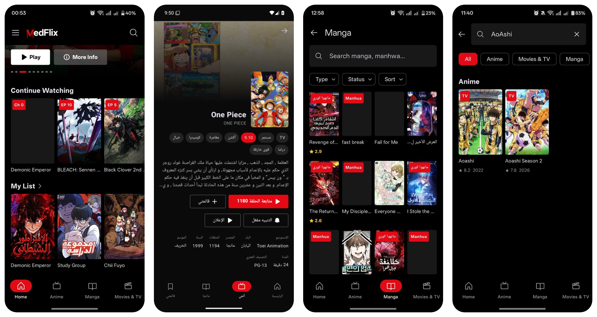
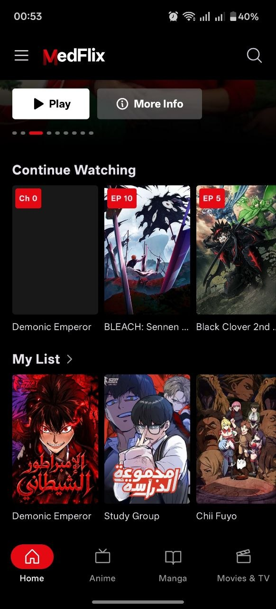
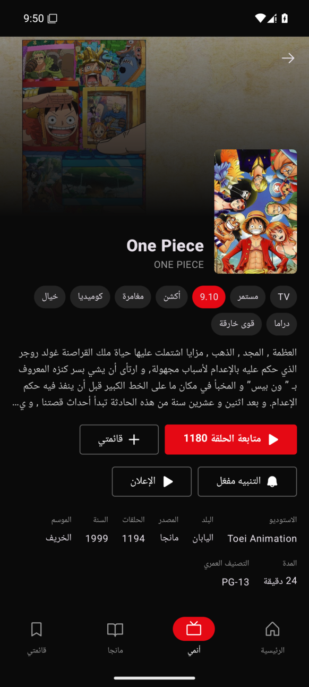
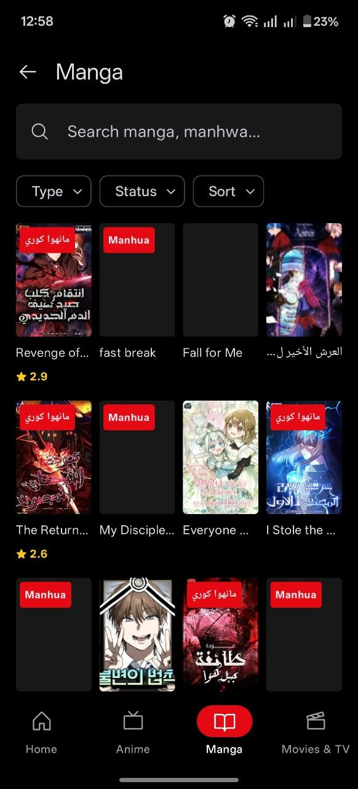
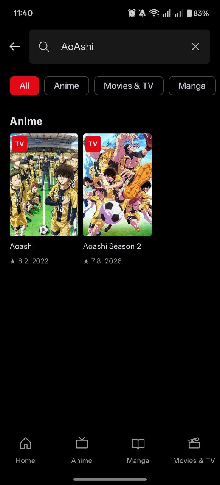
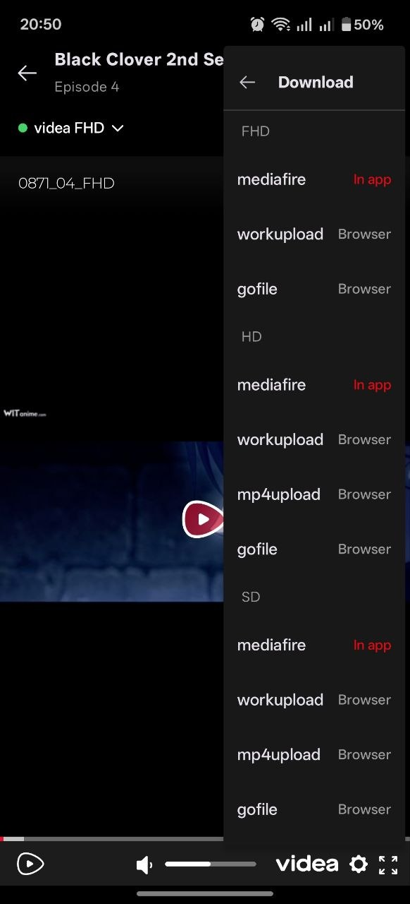
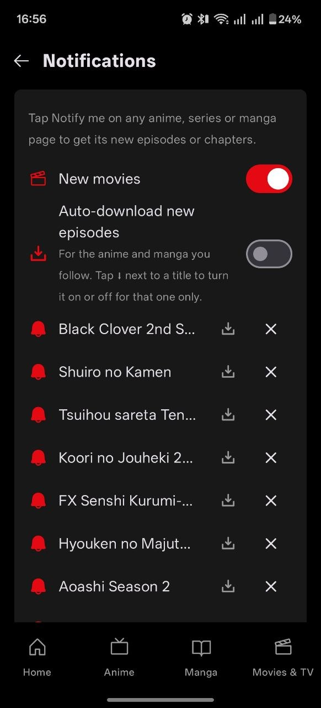

<p align="center">
  
</p>

<h1 align="center">Medflix</h1>

<p align="center">
  A Netflix-style app for Arabic anime, manga, and movies &amp; series.<br>
  Arabic first, with a full English interface. For Android and desktop.
</p>

<p align="center">
  <a href="https://github.com/Medamine-Bahassou/Medflix/releases/latest/download/MEDFLIX.apk">
    
  </a>
</p>

<p align="center">
  <a href="https://github.com/Medamine-Bahassou/Medflix/releases/latest"></a>
  <a href="https://github.com/Medamine-Bahassou/Medflix/releases"></a>
  
</p>

<p align="center">
  
</p>

## Install

**Android (7.0 or newer)**

1. Tap the download button above to get `MEDFLIX.apk`.
2. Open the file. Android asks you to allow installs from this source the first time.
3. Open Medflix. New versions are offered inside the app from then on, and your data stays when you update.

**Desktop** has no packaged build yet, so run it from source (see [Development](#development)).

## Features

Features marked 📱 are on Android only, and 🖥️ on desktop only. The rest are on both.

### Watch

- Anime, anime movies, dubbed titles, movies and series, all in one app
- Choice of servers per episode, with backup servers when one fails
- Resume where you left off from **Continue Watching**, and move between episodes from the player
- Trailers, seasons, jump to episode, and **More Like This**
- 📱 Picture-in-picture when you leave the app
- 📱 Cast to a Chromecast or Android TV

### Read

- Manga, manhwa and manhua, merged from several sources
- Vertical and horizontal reading
- 📱 Continuous reading from one chapter into the next
- Auto-scroll with adjustable speed, and a lock for the on-screen controls
- Jump to any chapter, and mark chapters as read
- Browse trending, latest, most read and new series, with type, status and sort filters

### Discover

- Search across all sections with title suggestions, narrowed to anime, movies & TV, or manga
- 🖥️ Anime filters for type, status, year, season, language, country, source and genres
- Weekly anime schedule with air times, searchable by show
- Ratings from AniList and IMDb
- Filler and part-filler anime episodes marked in the episode list and the player, with an option to hide filler, from [Anime Filler List](https://www.animefillerlist.com)
- Episode rating graph on the show page, from IMDb and [TVmaze](https://www.tvmaze.com/api) (CC BY-SA)
- Characters and cast, with portraits and voice actors ([sources](#character-and-cast-metadata))

### Downloads

- Download episodes and manga chapters to watch or read offline
- Pause and resume, or select several episodes or chapters and download them together
- 📱 Wi-Fi-only mode, so downloads never use mobile data
- 📱 Automatic deletion of episodes once you've watched them
- 📱 Storage usage view, and playback in another player such as VLC or MX Player

### Stay up to date

- 📱 Notifications for new episodes and chapters of the titles you follow, and for new movies
- 📱 Auto-download new releases, turned on per title
- 📱 Home screen widget for what you're watching
- 📱 In-app updates from the latest GitHub release

### Make it yours

- **My List** to keep your titles
- 📱 Search inside My List
- 📱 Custom categories inside My List
- Long-press a card to hide it from every page, and bring it back any time
- Arabic (right-to-left) and English
- Pick up to 5 sections for the phone's bottom bar; the rest stay in the side menu
- Black AMOLED theme
- Built-in form for feedback and bug reports

### Works offline

- Pages open instantly from a saved copy and refresh in the background
- Saved pages stay available offline for 90 days
- 📱 Cache manager that shows and clears pages, images and player data
- 📱 Optional `MEDFLIX` folder on the phone, so your list, history, settings and downloads survive a reinstall

## Screenshots

<table>
  <tr>
    <td align="center"><br><sub>Home</sub></td>
    <td align="center"><br><sub>Anime page, in Arabic</sub></td>
    <td align="center"><br><sub>Manga page</sub></td>
    <td align="center"><br><sub>Manga browser</sub></td>
  </tr>
  <tr>
    <td align="center"><br><sub>Search</sub></td>
    <td align="center"><br><sub>Player and downloads</sub></td>
    <td align="center"><br><sub>Notifications</sub></td>
    <td></td>
  </tr>
</table>

## Development

Medflix has two apps that share the same sites and user data format:

- **Desktop:** a plain JavaScript web front end in Electron
- **Android:** a native Kotlin and Jetpack Compose app

### Run on desktop

```sh
npm install
npm start
```

### Build the Android APK

Needs the Android SDK and a JDK.

```sh
npm run apk   # outputs MEDFLIX.apk
```

### Layout

| File | Role |
|------|------|
| `main.js`, `preload.js` | Electron main process and preload API |
| `mobile.js` | Capacitor stand-in for the preload API |
| `index.html`, `app.js`, `style.css`, `icons.js` | Desktop UI and routing |
| `scraper.js` | HTML parser |
| `filter.js`, `manga.js`, `cinema.js` | Filter page, manga and movies sections |
| `selftest.js` | Live scraper check: `npx electron selftest.js` |
| `assets/` | App icons and the download button |
| `docs/screenshots/` | README images |
| `android/` | Android project; the native app is in `app/src/main/java/com/medanime/app/ui/` |

`www/` is generated by `npm run build:web`.

## Character and cast metadata

Desktop (`cast-info.js`) and native Android (`ui/Credits.kt`) use:

- [AniList](https://docs.anilist.co/guide/graphql/): anime and manga/manhwa characters, portraits, and Japanese anime voice actors. Characters appear as each page arrives while the remaining pages load. Jikan is a fallback.
- [TVmaze](https://www.tvmaze.com/api): series cast and character portraits, with a source link and CC BY-SA attribution.
- [Wikidata](https://www.mediawiki.org/wiki/Wikibase/API): film cast and series fallback. Actor portraits are used when a character has no picture. Entity requests are split into batches of 50.

No API keys are needed. Credits load separately from the title page. Coverage depends on the source; TVmaze's show endpoint lists the main cast, and unlisted characters or unknown credits cannot be filled in. Manga does not display voice actors from an adaptation. Ambiguous movie/series matches are left unmatched.

Validation:

```sh
node --test tests/*.test.js
MEDFLIX_LIVE_CREDITS=1 ./android/gradlew -p android testDebugUnitTest --tests '*CreditsTest' --tests '*CreditsLiveTest'
```

The live test checks anime, manga, manhwa, films, series, and character pagination against the actual services; it is skipped unless explicitly enabled. These checks verify metadata integration, not a visual UI inspection.
