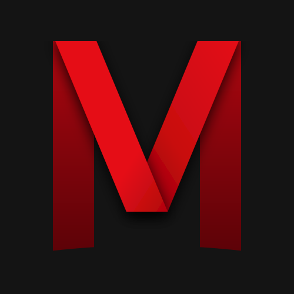

<p align="center">
  
</p>

<h1 align="center">Medflix</h1>

Netflix-style client for Arabic anime, manga and movies, as an Electron desktop app and a Capacitor Android app.

- Anime, manga, and movies & series sections
- Airing schedule, filters, search with title suggestions, offline cache

## Run (desktop)

```sh
npm install
npm start
```

## Build the Android APK

Needs the Android SDK and a JDK.

```sh
npm run apk   # outputs MEDFLIX.apk
```

## Layout

| File | Role |
|------|------|
| `main.js`, `preload.js` | Electron main process and preload API |
| `mobile.js` | Capacitor stand-in for the preload API on Android |
| `index.html`, `app.js`, `style.css`, `icons.js` | UI and routing |
| `scraper.js` | HTML parser |
| `filter.js`, `manga.js`, `cinema.js` | Filter page, manga and movies sections |
| `selftest.js` | Live scraper check: `npx electron selftest.js` |
| `assets/` | App icons |
| `android/` | Capacitor Android project |

`www/` is generated by `npm run build:web`.
